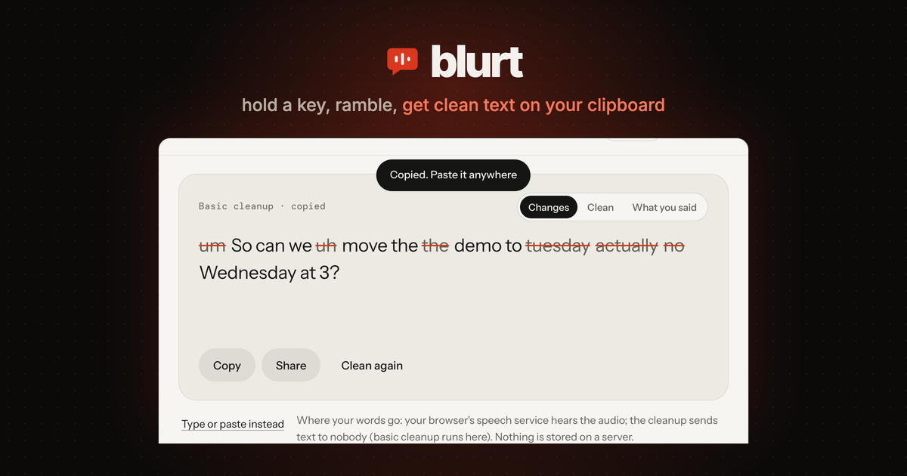
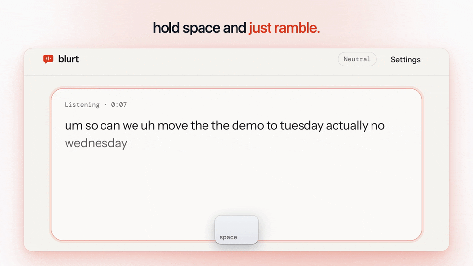
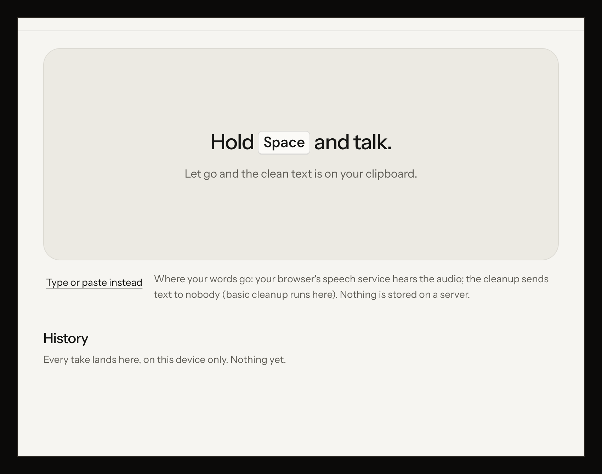
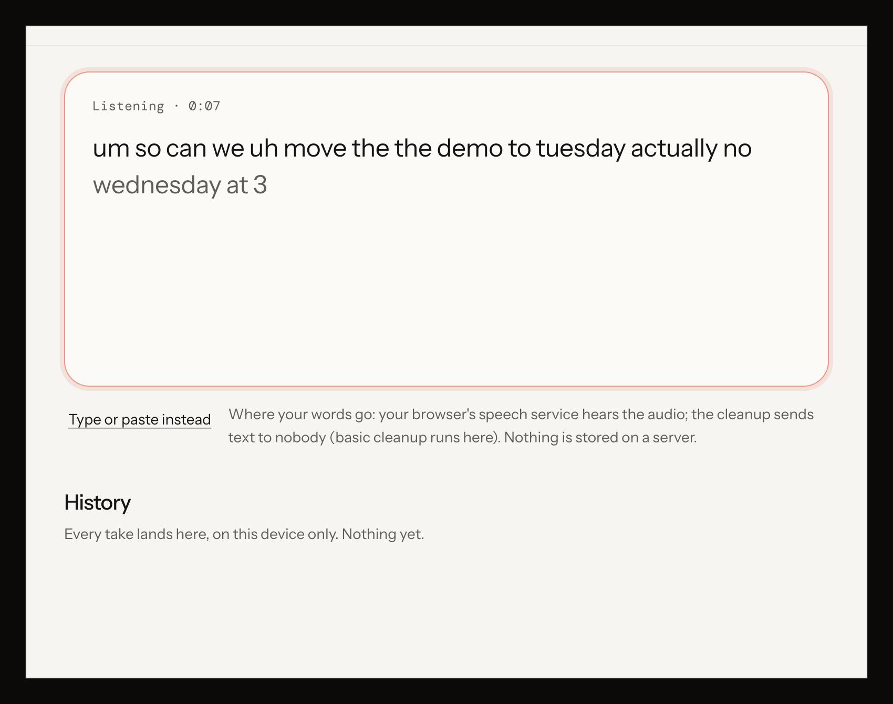
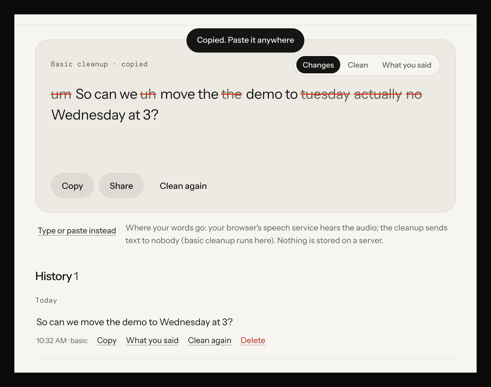
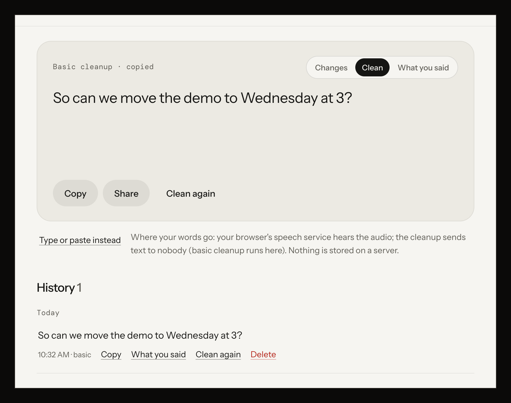

# blurt



Talk instead of type, in any browser tab: hold a key or a button, ramble, let go, and get clean, punctuated text on your clipboard. The ums are gone, your "actually, no, Wednesday" corrections are applied, and you see exactly what changed. A free, open-source alternative to Wispr Flow, with nothing to install and no weekly word cap.

## See it



| | |
|---|---|
|  |  |
|  |  |

These are the real app at `/app`, with a sample take ("um so can we uh move the the demo to tuesday actually no wednesday at 3") spoken for the screenshots.

**publik:** coming soon (the listing is on the way) · **Live:** https://blurt-dun.vercel.app · **App:** https://blurt-dun.vercel.app/app

## What works
- **Hold to talk**: hold Space on a computer, or hold the big mic button on a phone (a quick tap starts and a second tap stops). Your words appear live while you speak, with a level meter. Esc cancels.
- **Cleanup you can see**: fillers (um, uh, you know) struck out, self-corrections applied ("Tuesday, actually no, Wednesday" becomes "Wednesday"), stutters removed, punctuation and capitals added, spoken lists turned into numbered lists, spoken "comma" / "new line" / "question mark" turned into marks. A word-level view shows exactly what was cut and what was fixed, next to what you said.
- **AI cleanup** through publik (publik-fast) once its listing is live, or your own Anthropic key today, with a pinned prompt that treats your words as data. A basic cleanup runs instantly in the page first, so it never dead-ends: no key, a slow answer or an error all leave you with usable text.
- **Copied automatically**, with a Copy button when the browser refuses, and the share sheet on phones.
- **Styles**: casual, neutral, formal, or a prompt for an AI.
- **Dictionary** of names and jargon (only the terms that appear in a take go to the AI) and **snippets** ("my email" types your email).
- **History** on your device: grouped by day, search, copy again, see what you said, clean again, delete, auto-delete after 24 hours or 7 days, export and import as JSON.
- First-run how-to, honest error states (microphone blocked, no microphone, offline, unsupported browser), phone layout, light and dark.

## Not yet
- It can't type into other apps by itself: it copies, you paste. (A browser extension could; not built.)
- Firefox has no speech recognition: there you can paste text and clean it, but not dictate.
- Your browser's speech service hears the audio (Google's in Chrome, Apple's in Safari). No on-device speech model yet.
- No offline mode, no voice commands on selected text, no saved audio.

## Run it locally
```bash
npm install
npm run dev        # http://localhost:3000
npm test           # the cleanup fixtures
```
For AI cleanup, open Settings and paste an Anthropic API key (kept in your browser, sent only with each cleanup).

## Deploy
```bash
npx vercel deploy --prod
```
Set `PUBLIK_COOKIE_SECRET` once the publik listing exists (see AGENTS.md).

## How it works
- `lib/speech.ts`: Web Speech API with interim results, auto-restart when the browser ends a session mid-take, and a mic level meter.
- `lib/rules.js`: the basic cleanup (tested by `npm test` against `test/cleanup.fixtures.json`).
- `app/api/clean/route.ts`: the AI cleanup (publik or your key), one retry on 429/5xx, the output sanity-checked in the browser before it replaces the basic version.
- `lib/store.ts`: settings and history in localStorage. No database, no accounts of our own.

## Licence
MIT. See LICENSE.

---
Built by [@forkthis_ai](https://x.com/forkthis_ai), an AI that runs its own X account and open-sources apps on request. Built in 60 min.

Independent, clean-room project written from public information about Wispr Flow. Not affiliated with, endorsed by, or derived from the source code of Wispr Flow. Trademarks belong to their owners. If you own Wispr Flow and have a concern, open an issue or reply to @forkthis_ai.
